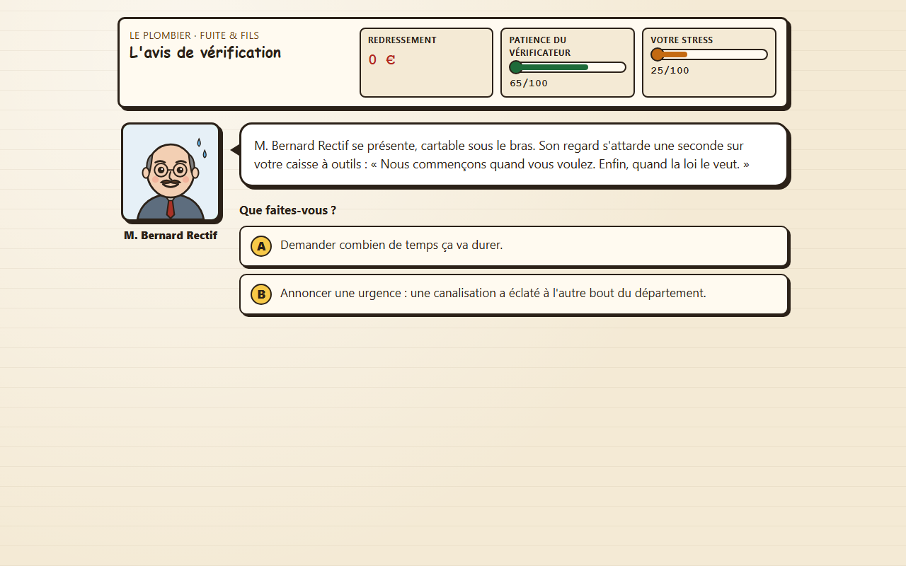

# Taxes & Furious

Jeu web humoristique : choisissez un profil (un métier caricatural) et subissez un contrôle fiscal. Scénario à choix multiples, trois jauges (redressement, patience du vérificateur, votre stress), plusieurs fins, et après chaque choix l'encadré « Ce que dit vraiment la loi », qui cite l'article de loi concerné.

> Jeu humoristique. Ce n'est pas un conseil fiscal. Entreprises et personnages 100 % fictifs. L'écran titre et l'écran de fin affichent la date à laquelle les textes de loi cités ont été vérifiés.



Six profils : le restaurateur, l'influenceuse, le plombier, le consultant, la coiffeuse et le galeriste. Un tronc commun (avis de vérification, fichier des écritures comptables, proposition de rectification) et des chapitres propres à chaque métier. Aucun hasard : mêmes choix, même fin.

## Jouer en ligne

https://taxes-and-furious.pages.dev : version publiée depuis la branche `main`. Le jeu est un site statique : aucun compte, aucun cookie, aucune requête vers un autre site. Seul le meilleur score de chaque profil est gardé dans votre navigateur (`localStorage`).

## Lancer en local

Prérequis : Python 3 (bibliothèque standard seulement). Toutes les commandes se lancent depuis la racine du dépôt.

```bash
python lancer.py
```

puis ouvrir http://127.0.0.1:8796/ dans un navigateur. `Ctrl+C` pour arrêter.

Autre port (si 8796 est pris, le lanceur le dit et s'arrête avec un code non nul) :

```bash
python lancer.py --port 8797
```

Depuis un téléphone ou un autre ordinateur du réseau local :

```bash
python lancer.py --lan
```

Le lanceur affiche l'adresse à ouvrir (`http://<adresse LAN>:8796/`). Attention : en `--lan`, tout le dossier du dépôt est servi aux machines du réseau local ; à réserver à un réseau de confiance.

## Tester

Prérequis :

- Node.js 22 ou plus récent (l'intégration continue utilise Node 26). Aucune dépendance npm.
- Python 3 (test du lanceur).
- chrome-headless-shell, le navigateur sans fenêtre de Playwright, pour les tests d'interface. Installation, une fois :

```bash
npx -y playwright@1.63.0 install chromium-headless-shell
```

Les tests le trouvent dans le cache Playwright de la plateforme (Windows, Linux ou macOS), ou au chemin donné par la variable `CHROME_HEADLESS_SHELL`. Sans navigateur, les tests d'interface échouent : ils ne sont jamais sautés.

Tous les tests, en une commande (moteur, validateur, contenu de `data/`, guide, interface dans le navigateur sans fenêtre, lanceur, construction du site) :

```bash
node --test tests/
```

Résultat attendu en fin de sortie : `fail 0` et `skipped 0` (30 s à 2 min selon la machine). Les mêmes tests tournent sur chaque push et chaque pull request (`.github/workflows/tests.yml`).

Valider les données seules :

```bash
node outils/valider.mjs
```

Résultat attendu : `OK : donnees valides (data) ; profils verifies : restaurateur, influenceuse, plombier, consultant, coiffeuse, galeriste ; 0 avertissement(s)`. Options : `--racine <dossier>`, `--profil <id>`, `--sans-couverture`.

Construire le site publié (dossier `dist/`, ignoré par git : `index.html`, `css/`, `js/`, `data/` et le fichier d'en-têtes `_headers`) :

```bash
node outils/construire.mjs
```

Refaire les captures des 5 écrans (1280x800 et 375x740) d'un profil dans `docs/captures/` :

```bash
node outils/captures.mjs --donnees data --profil plombier
```

## Contribuer

Les contributions passent par pull request. Un profil est un dossier de données : en ajouter un ne demande aucune ligne de code. Pas à pas, avec un exemple complet : [docs/CREER_UN_PROFIL.md](docs/CREER_UN_PROFIL.md). Ajouter une mécanique de jeu (mini-jeu, type de scène) : [docs/AJOUTER_UN_TYPE_DE_SCENE.md](docs/AJOUTER_UN_TYPE_DE_SCENE.md) ; place de chaque module : [docs/ARCHITECTURE.md](docs/ARCHITECTURE.md). Règles, relecture et vérifications avant d'ouvrir une pull request : [CONTRIBUTING.md](CONTRIBUTING.md).

La règle qui ne se négocie pas : la fiction est dans la mise en scène, la loi est dans l'encadré et doit être exacte. Toute notion juridique nouvelle s'appuie sur un article lu dans le texte officiel, ajouté à `data/references.json` dans la même pull request.

Spécification du jeu (format des données, exigences numérotées `EX-xxx` citées dans le code et les tests) : [docs/spec/SPEC.md](docs/spec/SPEC.md).

## Organisation

```
index.html, css/, js/       interface statique ; js/moteur.js = moteur pur, js/interface.js = DOM,
                            js/types/ = types de scène (choix, tri), js/animations.js = animations
data/                       contenu : tronc.json, profils/, communs/, references.json (sources juridiques)
outils/valider.mjs          validateur des données
outils/construire.mjs       construction du site publié (dist/)
outils/captures.mjs         captures d'écran sans fenêtre
outils/verifier-termes.mjs  recherche de termes interdits listés dans un fichier local non publié
lancer.py                   serveur HTTP local
tests/                      node --test ; tests/donnees = données de démonstration
docs/                       spécification, guides (profil, type de scène), architecture, captures
```

## Licence

Deux licences, pour que chacun puisse réutiliser le jeu :

- le **code** (`js/`, `css/`, `index.html`, `outils/`, `tests/`, `lancer.py`) est sous licence MIT : [LICENSE](LICENSE). Vous pouvez le copier, le modifier et le redistribuer, y compris dans un projet commercial, en gardant la mention de copyright et le texte de la licence ;
- le **contenu** (`data/` : scénario, profils, textes, portraits SVG, illustrations WebP ; et les captures de `docs/captures/`) est sous licence CC BY 4.0 : [LICENSE-CONTENU.md](LICENSE-CONTENU.md). Vous pouvez le partager et l'adapter, y compris commercialement, à condition de créditer « Taxes & Furious, les contributeurs » et d'indiquer la licence. Les illustrations ont été générées avec l'aide de Gemini (Google), puis sélectionnées et retouchées (prompts : [docs/art/PROMPTS.md](docs/art/PROMPTS.md)).

Les textes officiels cités (articles de loi) ne sont couverts par aucune des deux licences : personne ne peut se les approprier.

En ouvrant une pull request, vous acceptez que votre contribution soit publiée sous ces mêmes licences.

## Avertissement

Jeu humoristique. Ce n'est pas un conseil fiscal. Les explications résument des textes officiels à la date de vérification affichée dans le jeu ; pour une situation réelle, adressez-vous à un professionnel ou à l'administration fiscale. Entreprises et personnages sont entièrement fictifs.
